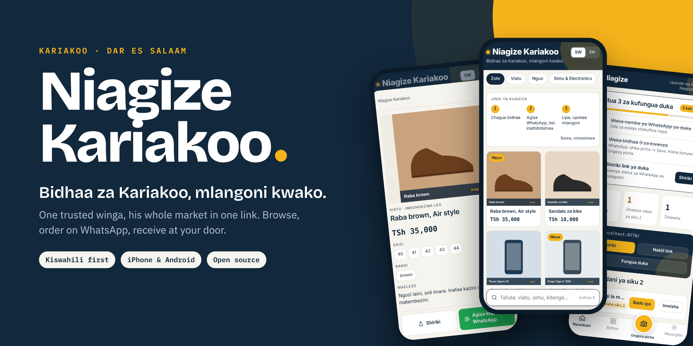
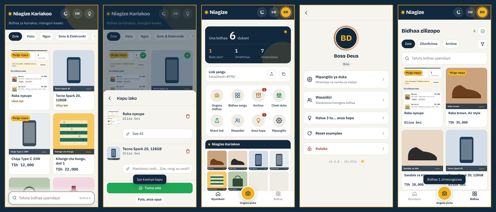
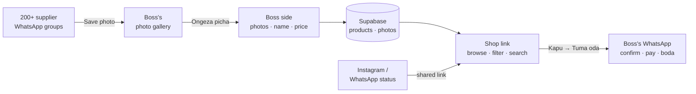

<p align="center">
  
</p>

<p align="center">
  <a href="https://pengo01.github.io/winga/"><b>Open the shop</b></a> ·
  <a href="https://pengo01.github.io/winga/admin/">Boss side</a> ·
  <a href="#how-it-works">How it works</a> ·
  <a href="#principles">Principles</a> ·
  <a href="#roadmap">Roadmap</a> ·
  <a href="LICENSE">MIT License</a>
</p>

---

## Why it exists

In Kariakoo, a **winga** is the person who knows which shop has the stock, what the real price is today, and who sells fakes. A good one sits in 200+ supplier WhatsApp groups and posts what he finds to his status. Customers see it, message him, bargain, pay, and a boda brings it.

It works. But it lives in WhatsApp status that disappears in 24 hours, in a phone gallery, and in his head. A customer can't browse. He can't see what sold. Nothing builds up.

**Niagize Kariakoo turns one trusted winga's status into a shop that stays.** Not a marketplace. One winga, his market, one link.

## What it does

<p align="center">
  
</p>

| Side | Screen | What it does |
|---|---|---|
| Mteja | **Nyumbani** | Masonry grid: photo, name, short description, price, WhatsApp "Chat nasi", quality stars, how many ordered, add to basket. Search and 6 categories (Nguo & Fashion, Viatu, Electronics, Urembo, Mama & Watoto, Nyingine); the chosen one scrolls into view |
| Mteja | **Aina** | Temu-style: categories on the left, sub-categories as icon circles on the right |
| Mteja | **Kapu → Tuma oda** | Quantities, a Maelekezo (spec) note per item, delivery (Inaharaka / Utumwe Leo), address. Creates order **#NK-XXXXX** and sends the seller one WhatsApp message with a link to that order |
| Mteja | **Oda page** | Live status (Imepokelewa → Nakurudia → Ankara → Imelipwa → Imekamilika), items, total, payment numbers |
| Mteja | **Mimi** | Optional account: username + password (Google sign-in ready), one account per WhatsApp number, history and reorder, addresses (map search or typed), help centre, settings, delete account |
| Boss | **Nyumbani** | Shortcuts first (Oda, Archive, Share link, Cheki duka), then sales, orders, visitors, conversion, 7-day chart, customer funnel, top products |
| Boss | **Oda** | Mpya · Zinasubiri · Zimekamilika, search by order number. One next step per order: opened orders move to "Inafanyiwa kazi" after 2 minutes → Tuma ankara (delivery fee per order, agreed total after bargaining) → Imelipwa → Imekamilika, or Sitisha with a written reason |
| Boss | **Ongeza / Bidhaa** | Pick up to 3 photos at once, name, category + sub-category, price (always), quality stars. Edit and archive icons on every card; archive after 60 days |
| Boss | **Profile** | Shop settings (WhatsApp, payment numbers), assistants (share sign-in link, reset password), username + password |

## How it works



Today, ordering finishes on WhatsApp, where customers already are. In-app orders come only after the numbers show customers actually tap "Tuma oda" (see [Roadmap](#roadmap)).

## Use it

**Customers:** open **https://pengo01.github.io/winga/**. On a phone, add it to the Home Screen to come back in one tap.

**Boss (iPhone):**
1. Open **https://pengo01.github.io/winga/admin/** in **Safari**, tap **Share → Add to Home Screen**.
2. Open **Niagize Boss** from the Home Screen and sign in. Accounts are created by the Super Admin.
3. Tap the bulb for **Hatua 3**: WhatsApp number, three products, share the link.

> On iPhone, "Share → app" from WhatsApp isn't possible for web apps (WebKit limitation), so photos come from the gallery: in WhatsApp, hold a photo → **Save**, then **Ongeza picha**.

**Super Admin:** creates accounts in Supabase (Authentication → Users → Add user, *Auto Confirm*) and grants a role in `public.admins` (`super_admin` or `boss`).

## Principles

1. **Augment WhatsApp, never replace it.** It's where the winga and his customers live.
2. **One winga, not a marketplace.** His trust is the product.
3. **Protect his edge.** Suppliers and inside prices are never shown to customers.
4. **Fresh or hidden.** Stale stock breaks trust; products expire unless confirmed.
5. **Don't hold money.** Payments happen outside the app. We record, we don't touch.
6. **Borrow the basics, innovate on go-to-market.** Shop grids and order flows are solved problems; reach and trust are not.

## Under the hood

| | |
|---|---|
| **Frontend** | Plain HTML + JavaScript, no build step, hosted on GitHub Pages. Works offline from cache |
| **Backend** | Supabase: Postgres, Auth (email + password), Storage for photos |
| **Security** | Row Level Security: visitors read live products only; costs live in `product_private` (admins only); only admins upload or edit. See [`supabase/schema.sql`](supabase/schema.sql) |
| **Photos** | Shrunk on the phone before upload: 1080 px full, 400 px thumbnail |
| **Search** | Fuse.js fuzzy search, so "kiatu" finds "viatu" |
| **Language** | Kiswahili first (short, M-Pesa style), English switch. All words live in one table in `shared/core.js` |

```
index.html             customer shop
admin/                 Boss side (Niagize Boss)
shared/                core.js (language, data layer), style.css, config.js (public Supabase URL + anon key)
supabase/schema.sql    tables, security rules, storage bucket
pocket/                v0.1: the original single-winga pocket tool (where this started)
docs/                  README images
```

The anon key in `shared/config.js` is public by design. Row Level Security decides who can read or change what.

## Roadmap

Effort follows one rule: **metrics 50% · onboarding 40% · features 10%.**

```
 ✅ Shop + Boss side ──► ✅ Onboarding pass 1 ──► ✅ Review #1 ──► ✅ v2: orders, accounts, dashboard ──► ▶ Learn from real orders ──► In-app orders ──► Delivery · rating · reorder · alerts ──► WhatsApp forward bot · Instagram cards
```

- **Metrics next:** visits, product views, order taps, products added per day, days active.
- **In-app orders** (bargain, invoice, payment proof, verify) ship only if metrics show customers tap "order".

## Where it started

Niagize Kariakoo grew out of **Winga Pocket** (`/pocket/`), a phone-only tool for a winga's catalog, margin math and orders. Field feedback from a working winga turned it into a shop customers can browse. The pocket tool still works at **https://pengo01.github.io/winga/pocket/**.

## Contributing

Open source under the [MIT License](LICENSE). Issues and pull requests are welcome, especially from people who know Kariakoo, wingas, or Tanzanian payments. Keep the principles: if a change takes power away from the winga, it doesn't belong here.

---

<p align="center"><sub>Built in Dar es Salaam for the wingas of Kariakoo. MIT licensed.</sub></p>
