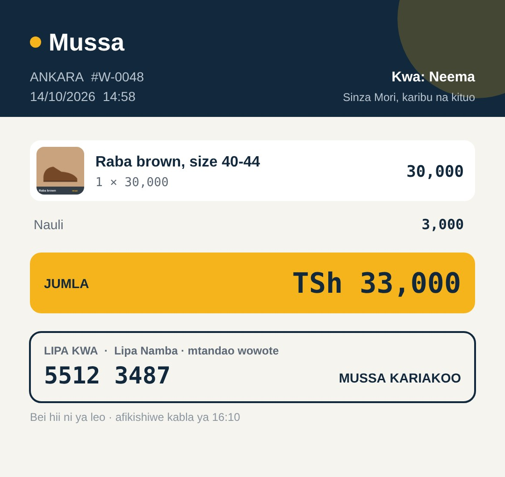
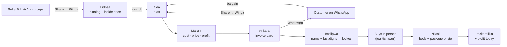

<p align="center">
  
</p>

<p align="center">
  <a href="https://pengo01.github.io/winga/"><b>Open the app</b></a> ·
  <a href="#install-on-a-phone">Install on a phone</a> ·
  <a href="#how-it-works">How it works</a> ·
  <a href="#principles">Principles</a> ·
  <a href="#roadmap">Roadmap</a> ·
  <a href="LICENSE">MIT License</a>
</p>

---

## Why Winga exists

In Kariakoo, a **winga** (or *dalali*) is the person who knows which shop has the stock, what the real price is today, and who sells fakes. Sellers post their goods in WhatsApp groups. Customers message the winga: *"Viatu brown 42, kabla ya saa nne?"* He finds it, bargains, buys, and sends it by boda.

His commission is the **jua kichwani**: the sun on his head as he walks the market all day.

Today all of that lives in WhatsApp chats, a phone gallery, and a calculator app. Prices get lost. Margins leak. Orders get forgotten. When a customer disputes a payment, there is no record.

Big platforms tried to replace the winga. They struggled, because trust in Kariakoo has a human face.

**Winga doesn't replace him. It goes in his back pocket.**

## What it does

<p align="center">
  
</p>

| Screen | What the winga gets |
|---|---|
| **Leo** | Today's profit as the big number. Waiting orders sorted by deadline. A nudge when catalog prices are three or more days old. |
| **Bidhaa** | His personal catalog. Seller photos shared straight in from WhatsApp, with his inside price and how old that price is. |
| **Oda** | Cost in, price out, profit live, per item and per basket. One tap prices everything at his commission. |
| **Ankara** | A clean invoice card sent to the customer on WhatsApp. Items, total, Lipa Namba. Seller and cost never appear. |
| **Imelipwa** | Payer name and last transaction digits lock the order: item, price and address frozen. His defence in a dispute. |
| **Njiani → Imekamilika** | Optional package photo, boda name and plate sent to the customer, then Done adds the profit to today. |
| **Wauzaji** | His regular sellers, one tap to call or WhatsApp. |

<p align="center">
  
  <br><sub>The invoice card a customer receives on WhatsApp. Example data.</sub>
</p>

## How it works



WhatsApp stays home. Winga is the structured spine in the middle: stock comes in from seller groups, orders come in from customers, and everything that goes back out (invoice, payment thanks, boda details) goes through WhatsApp.

## Install on a phone

1. On an **Android** phone, open **https://pengo01.github.io/winga/** in Chrome.
2. Tap the menu, then **Install app** (or **Add to Home screen**).
3. Open Winga from the home screen. It starts with example data marked **MFANO**. Tap **Futa mifano, anza yako** to start fresh, then enter your name and Lipa Namba.
4. In WhatsApp, long-press a seller's photo, tap **Share**, then **Winga**. It lands in the app ready to save as an item or start an order.

> Sharing from WhatsApp into Winga works on Android with Chrome. On iPhone the app runs, but photos are added from the gallery instead.

## Principles

1. **Augment WhatsApp, never replace it.** WhatsApp is the winga's home. Take him out of it and you kill him.
2. **Protect his edge.** His seller relationships and inside prices are his livelihood. The customer never sees them.
3. **Automate friction, not judgment.** Searching, calculating, sharing and remembering go to the app. Bargaining and buying stay human.
4. **The invoice is the contract.** What the customer approved, at what price, to which address, before money moved.
5. **Don't hold money.** Winga records payments and proves them. It never touches the cash.
6. **His data stays with him.** Everything is stored on his phone. No account, no server. He can back it up and take it anywhere.

## Under the hood

| | |
|---|---|
| **App** | One HTML file, plain JavaScript, no framework, no build step |
| **Storage** | IndexedDB on the device; backup and restore as a JSON file in Settings |
| **Offline** | Service worker caches the app shell |
| **Share-in** | Web Share Target (`manifest.webmanifest` + `sw.js`) |
| **Share-out** | Web Share API with the invoice image, with a WhatsApp link and copy-text fallback |
| **Invoice** | Drawn on a canvas at 1080 px wide, sized for WhatsApp |
| **Language** | Kiswahili first, English toggle |
| **Type** | Bricolage Grotesque, IBM Plex Sans, IBM Plex Mono |

```
index.html             the whole app
sw.js                  offline + receives shares from WhatsApp
manifest.webmanifest   installable app + "Winga" in the Android share menu
icon-*.png             app icons
docs/                  README images
```

## Roadmap

```
 v0.1 Pocket ───────► v0.2 Field test ───────► B. WhatsApp + auto-pay ───────► C. ODA
 (one winga's tool)    one real winga,          order line on WhatsApp,          customer app,
                       one week, Android         payments that confirm             many wingas,
                                                 themselves                        quotes
```

**Measured in the field test:** time from customer message to invoice sent, calculator opens per day (target: zero), forgotten or disputed orders, and whether he still uses it in week two.

**Known limits:** no reminders while the app is closed; data lives on one phone until he backs it up; WhatsApp share-in is Android only, and takes the first photo when several are shared.

## Where photos and data live

```
 WhatsApp photo ──Share──► sw.js holds it for a moment ──► app shrinks it (max 720 px JPEG) ──► IndexedDB on the phone
                           (Cache "winga-share", deleted         ~40–90 KB per photo                (no server, no cloud)
                            as soon as the app reads it)
```

- **Only a small copy is kept.** The full-size photo stays in WhatsApp; Winga keeps a 720 px copy, enough for the catalog and the invoice card.
- **Room to spare.** Chrome lets one site use up to 60% of the phone's free disk. At about 70 KB a photo, 1,000 catalog photos is roughly 70 MB.
- **Protected from clean-ups.** Winga asks Chrome for persistent storage, so the phone won't clear it when space runs low. Settings shows whether that was granted and how much space Winga uses.
- **No orphans.** Deleting an item or replacing its photo removes the old photo too.
- **Real risks:** clearing Chrome's site data, uninstalling, or losing the phone wipes it. That is what **Pakua nakala** (backup) in Settings is for.

## Contributing

Winga is open source under the [MIT License](LICENSE). Issues and pull requests are welcome, especially from people who know Kariakoo, wingas, or Tanzanian payments. Keep the principles above: if a change takes power away from the winga, it doesn't belong here.

---

<p align="center">
  <sub>Built in Dar es Salaam for the wingas of Kariakoo. MIT licensed.</sub>
</p>
